<p align="center">
  
</p>

<h1 align="center">Meta Dashboard</h1>

<p align="center">
  <strong>A local-first personal observability system for time, sleep, focus, rest, and health context.</strong>
</p>

<p align="center">
  Meta turns the traces left across several personal dashboards and ActivityWatch into one explorable record of daily life.
</p>

<p align="center">
  
</p>

## What Meta is

Meta Dashboard is the overview layer above a collection of personal data projects. It combines media history, application activity, inactivity, context switching, sleep inference, naps, work/rest classifications, and selected health notes into a common timeline.

The project is built to answer practical questions that are difficult to see in any single source:

- When did I probably sleep, wake, nap, or return to sleep after an interruption?
- How much of the day was directed effort versus play, rest, or unclassified time?
- Were productive periods sustained, fragmented by context switching, or separated by long breaks?
- What source evidence supports an inferred sleep interval?
- How do sleep, screen exposure, medication notes, and headache burden line up over time?
- What changed today, this week, this month, or across the year?

It is both a working personal instrument and an evolving research surface. The interface preserves detailed evidence and manual controls because the underlying signals are imperfect and the person using the dashboard must remain the final authority.

## At a glance

| Area | What it provides |
| --- | --- |
| Daily overview | A calendar-centered summary of source activity, sleep, naps, work/play balance, and notable daily signals. |
| Sleep intelligence | Multiple isolated inference strategies, fragmented-night handling, wake-gap evidence, manual correction, and source guides for validation. |
| Work and rest | Cumulative pressure and runup views, explicit classification rules, sleep-excluded totals, and break-duration analysis. |
| Context switching | An alt-tab transition map that exposes switching density, focus time, app sequences, and likely cognitive churn. |
| Health context | Exploratory views joining headache burden, sleep duration, screen exposure, and discrete medication notes. |
| Long-range patterns | Typical-weekday profiles, source timelines, annual sleep calendars, and range-aware KPIs. |
| Local control | Static browser UI, local data artifacts, source-level update scripts, and browser-stored display preferences. |

## The daily observatory

The main screen is designed for scanning first and drilling down second. It brings the latest sleep estimate, range-aware KPIs, calendar history, source composition, and alerts into one view. Individual days open a detailed timeline rather than forcing every diagnostic signal onto the overview.

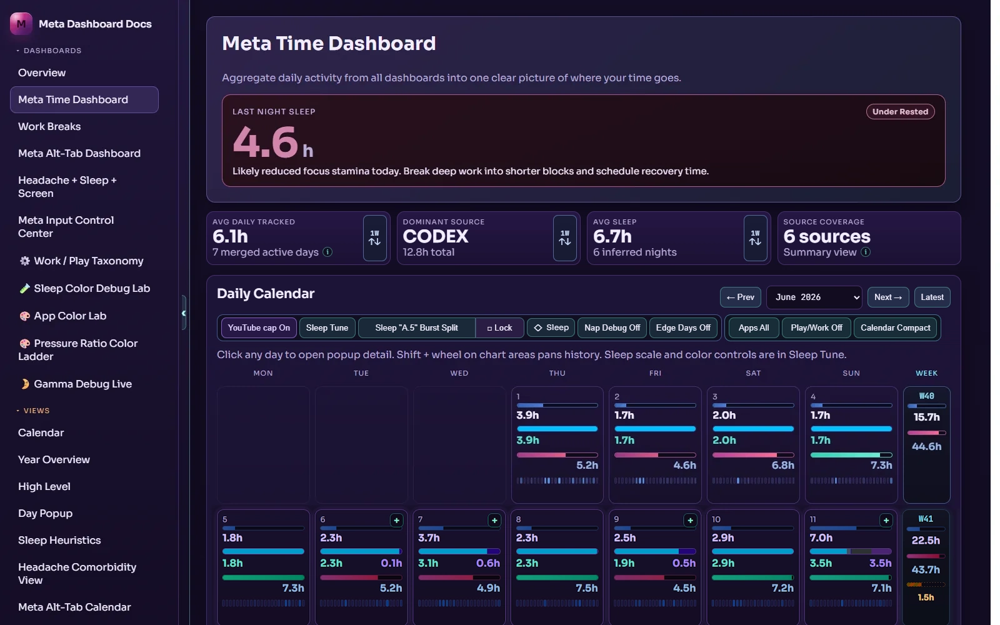

The calendar can be viewed through several lenses. Source colors show where time came from; sleep colors emphasize duration; work/play mode reuses the same classification model found in the deeper pressure charts. Navigation, range selection, and day detail stay linked so the dashboard works as both a current status display and a historical record.

## Sleep and nap intelligence

Sleep is the largest analytical subsystem in Meta. It uses ActivityWatch inactivity, window and web evidence, known media activity, lock/unknown states, and manually accepted or rejected intervals to estimate nights without pretending that inference is certainty.

The primary sleep overview keeps the essential evidence readable: the current strategy, total sleep, wake gaps, YouTube and Trakt guides, and the selected time window.

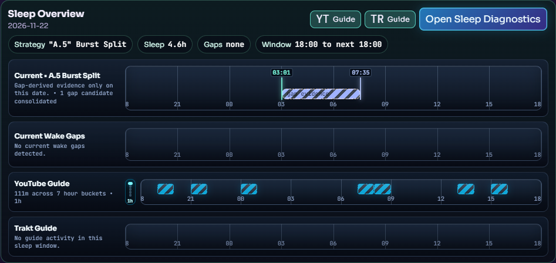

The diagnostic explorer remains available for difficult nights. It compares strategies side by side, exposes candidate cells and wake gaps, supports interactive segment correction, and keeps algorithm output separate from manual additions and rejections.

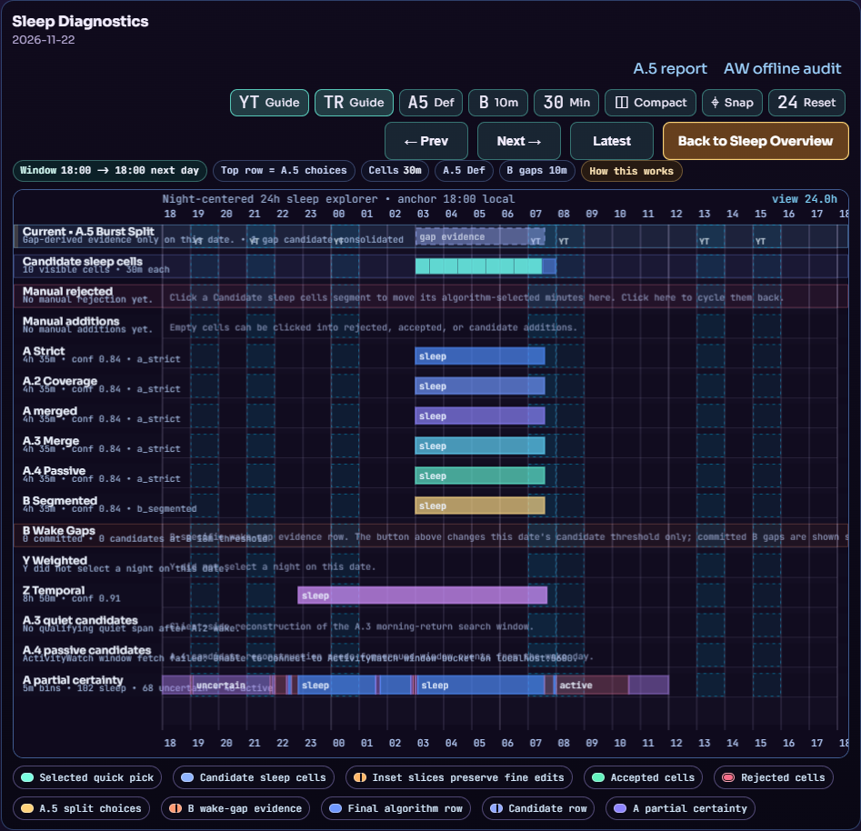

Current sleep capabilities include:

- Stable baseline and experimental strategies kept isolated from one another.
- Fragmented-night support with visible wake gaps rather than a forced single block.
- Per-day manual inclusion and exclusion of sleep segments.
- YouTube and Trakt evidence guides with adjustable temporal precision.
- Lock-screen and unknown-window handling to avoid treating machine noise as wakefulness.
- Nap detection and a separate conditional weekly nap measure.
- Annual sleep history with selectable strategies and explicit no-data states.

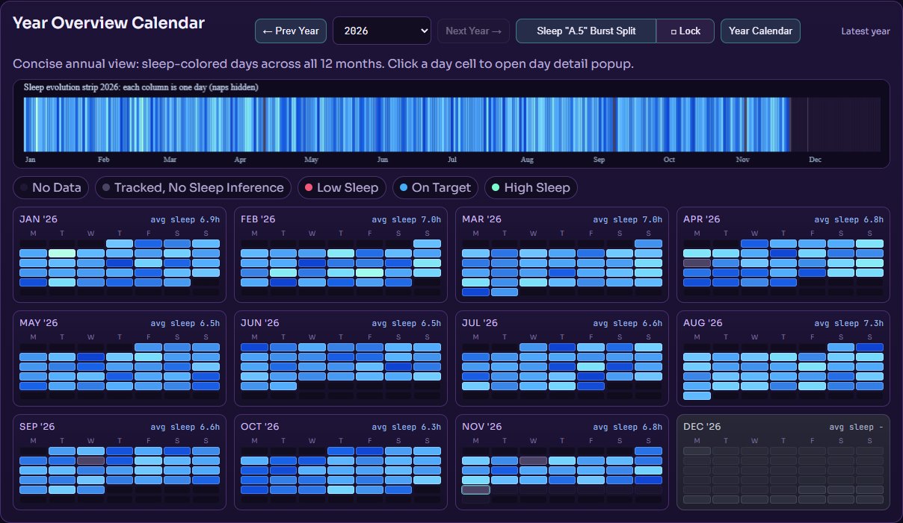

## Work, play, effort, and rest

Meta treats productivity as an inspectable taxonomy rather than a universal truth. Work is intentionally purple and play/rest is green. Sources can have strong, medium, weak, or neutral association with either root concept, while future intent labels can describe what an activity was productive *for* without silently changing the top-level totals.

The runup chart compares cumulative work and play over a chosen period. It excludes known sleep and can show gap heat, curve and daily modes, source overlays, and the doubled right axis used for overlapping time.

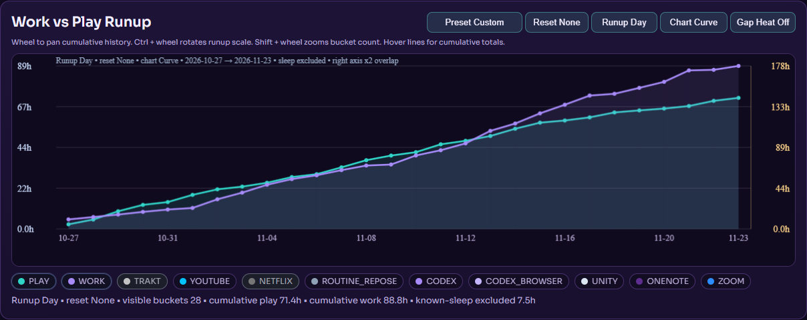

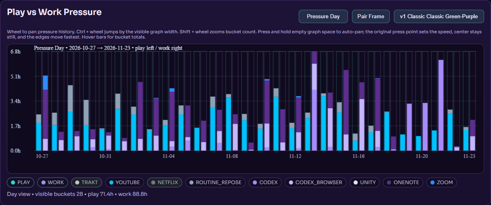

The classification surface makes the rules visible. It documents source membership, browser and application rules, confidence strength, recent scope, and the intentionally unresolved categories that need human judgment.

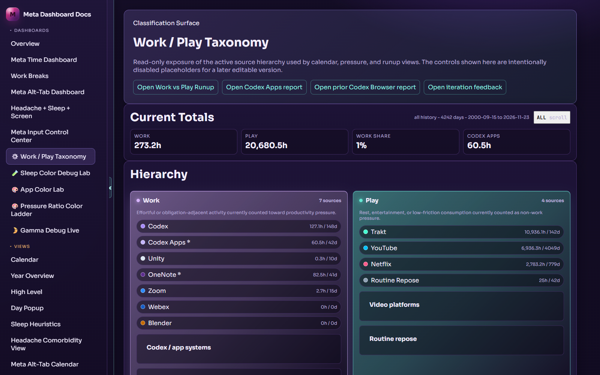

## Breaks and context switching

Work totals alone do not describe a day. Meta also measures the non-work spans between work bursts, making boom-and-bust patterns and long interruptions easier to inspect without inventing a speculative fatigue score.

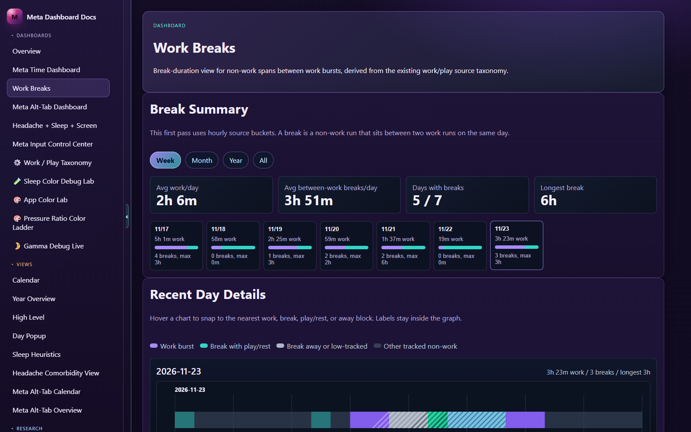

The companion Alt-Tab Dashboard uses ActivityWatch window transitions to show switching intensity and focus time. Its calendar summarizes each day; the detail view rotates app transitions into a time-based sequence map with density and work/play overlays.

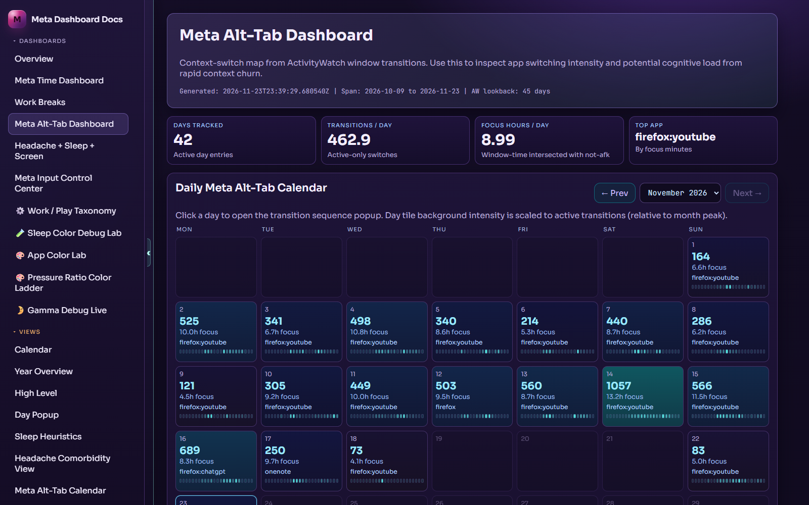

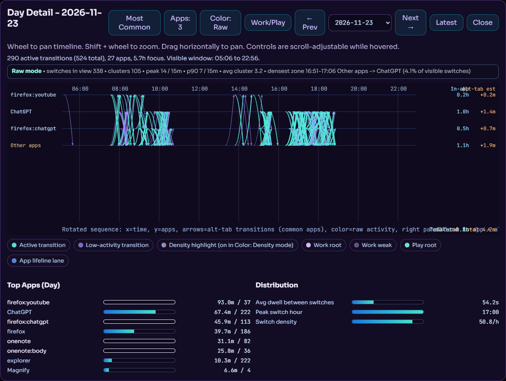

## Health context

The Headache + Sleep + Screen Explorer joins headache epochs from the OneNote/Google note pipeline with Meta's sleep and screen-time history. It is designed for within-person pattern finding: synchronized tracks make relationships visible, but the interface avoids presenting correlation as diagnosis or causation.

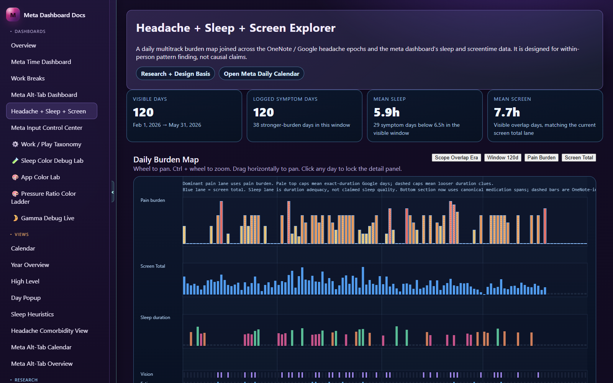

Discrete melatonin records can also appear in the daily calendar. Duplicate notes across sleep notes and PSS calendar entries are treated as duplicate documentation, not duplicate consumption. Future analysis is intended to compare medication timing, sleep outcomes, and environmental context while preserving provenance.

> Meta is a personal research and reflection tool, not a medical device. Its inferred states and descriptive associations should not be used as medical advice.

## Input controls and evidence

Meta keeps source filtering and inference defaults inspectable. The Input Control Center exposes wired Trakt limits, ActivityWatch and sleep defaults, impact previews, and deprecated controls that still matter for historical compatibility.

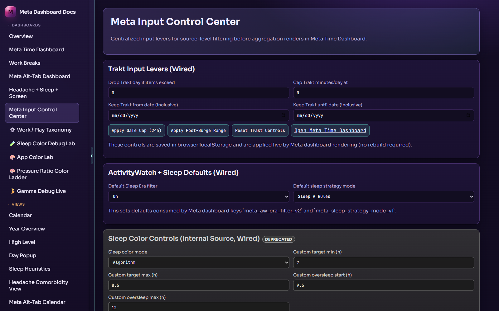

The repository also contains a substantial report library: regression analyses, performance investigations, sleep algorithm decisions, UI evaluations, data provenance notes, and postmortems. These reports are part of the product's memory and explain why sensitive analytical behavior changed.

## How the projects fit together

Meta does not replace the source dashboards. It consumes their normalized output, supplements it with ActivityWatch and note-derived evidence, then produces its own static data artifacts for browser exploration.

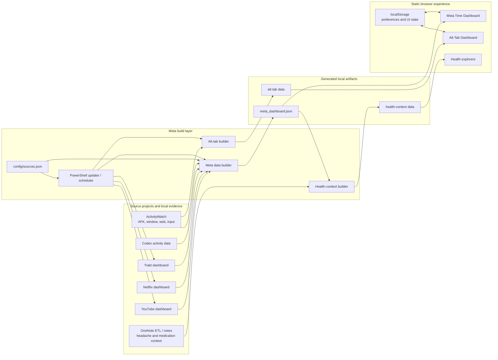

### Data model and privacy

- The dashboard is designed to run locally and does not require a hosted application backend.
- Source projects remain independently refreshable; Meta reads their generated JSON through adapters configured in `config/sources.json`.
- ActivityWatch supplies active/AFK and application evidence. Meta generally counts only non-AFK intervals unless a specific diagnostic view says otherwise.
- Generated JSON separates source metadata, issues, integrations, day and month aggregates, sleep evidence, strategies, and manual reconstruction state.
- Browser preferences and some interactive state live in `localStorage`; generated evidence remains in repository-local artifacts.
- Sensitive personal data is not required to be published with the application. The screenshots in this README are selected interface examples from the local development system.

## Project direction

Meta is moving from an aggregate dashboard toward a trustworthy personal observability system. The next stages emphasize explainability and consistency before prediction.

### Near term

- Centralize sleep authority so the calendar, overview, diagnostics, totals, and manual edits always resolve from the same canonical intervals.
- Make provenance explicit for every sleep segment, gap, override, and source-derived claim.
- Establish a direct, versioned OneNote ETL contract instead of relying on overlapping ad hoc exports.
- Continue frontend modularization and performance work as the single-page analytical surface grows.
- Consolidate shared controls and interval rendering across sleep, naps, activity guides, and work breaks.
- Harden backup, recovery, outage detection, and stale-data warnings for ActivityWatch and scheduled refreshes.

### Research and later-stage ideas

- Correlate melatonin timing and dosage notes with sleep onset, fragmentation, and duration.
- Add weather and indoor heat context without overcrowding the daily calendar.
- Expand the third taxonomy level into explicit intents such as emotional regulation, restoration, connection, and career action.
- Explore forward-looking risk indicators, such as unusually early passive media use, only after the descriptive model is stable and auditable.
- Add evidence fallbacks for machine-off and ActivityWatch outage periods while clearly distinguishing inference from observation.
- Develop richer boom-and-bust analysis without labeling fatigue or burnout from weak proxy data.
- Unify local serving and port discovery for the growing family of dashboard projects.

## Technical shape

This project deliberately uses a simple deployment model:

- Python builders normalize local JSON and ActivityWatch data.
- PowerShell orchestrates source refreshes and scheduled rebuilds.
- HTML, CSS, and JavaScript render the dashboards without a server-side application framework.
- Generated artifacts are served as static files and polled for updates.
- The Firefox launchers choose an available local port so multiple dashboards can coexist.

The simplicity is useful for local ownership and inspection. The main engineering pressure is now modularity: sleep analysis, calendar rendering, work/play classification, transitions, and report navigation have grown large enough to merit clearer domain boundaries.

## Run locally

### Quick launch on Windows

Use either launcher from the repository root:

```powershell
.\launch-meta-dashboard.ps1
```

```batch
launch-meta-dashboard.cmd
```

The launcher finds an available port, starts the local static server, and opens Meta in Firefox.

### Refresh all configured data

```powershell
powershell .\scripts\update_meta_dashboard.ps1
```

Useful options:

```powershell
powershell .\scripts\update_meta_dashboard.ps1 -SkipSourceRefresh
powershell .\scripts\update_meta_dashboard.ps1 -NoActivityWatch
powershell .\scripts\update_meta_dashboard.ps1 -ActivityWatchDays 180
powershell .\scripts\update_meta_dashboard.ps1 -ActivityWatchUrl "http://127.0.0.1:5600"
```

Configured sibling projects and updater commands are defined in `config/sources.json`. The frontend polls the generated Meta artifact and refreshes its embedded data when a newer build appears.

### Optional scheduled refresh

```powershell
powershell .\scripts\install_meta_dashboard_task_15min.ps1
```

## Repository map

```text
config/                 Source adapters and dashboard defaults
docs/                   Static dashboard, reports, generated data, and assets
scripts/                Builders, update orchestration, diagnostics, and tooling
tests/                  Focused regression and behavior checks
launch-meta-dashboard.* Unique-port Firefox launchers
HANDOFF.md              Current architecture, decisions, and open work
```

## Status

Meta is an active personal project. Its strongest capabilities are already useful day to day, while several views remain intentionally exploratory. The repository favors visible uncertainty, reversible experiments, and written regression history over presenting every derived number as settled fact.
